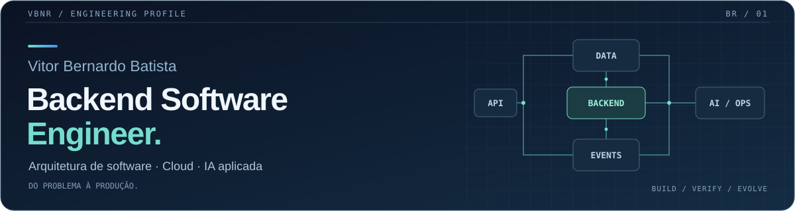
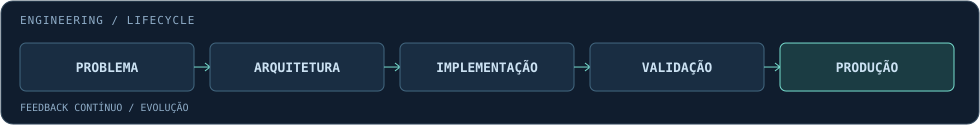
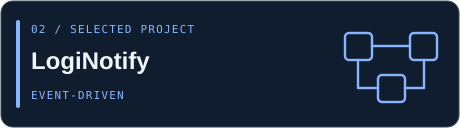
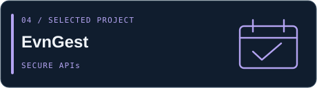

<div align="center">
  
  <br/><br/>
  <a href="https://linkedin.com/in/vitorbernardobatista"></a>
  <a href="https://vitorbernardo.vercel.app/"></a>
  <a href="mailto:vitorbernardotech@gmail.com"></a>
</div>

<br/>

## 01 / Além do código

> Gosto de entender o problema antes de escolher a tecnologia. Meu foco é construir software que funcione no mundo real.

Sou formado em **Análise e Desenvolvimento de Sistemas** e atuo como Analista de Sistemas no segmento jurídico. Minha especialidade é o desenvolvimento backend com Java e Spring Boot, mas minha experiência vai da arquitetura e das integrações à infraestrutura, segurança e sustentação em produção.

Trabalho também com inteligência artificial aplicada a sistemas e com agentes de desenvolvimento, combinando automação, especificações, testes e validação técnica.

## 02 / Do zero à produção

<table>
<tr>
<td width="100%">

**PROJETO PROFISSIONAL &nbsp; / &nbsp; Plataforma de gestão jurídica**

Construção de uma aplicação empresarial de ponta a ponta, sob minha responsabilidade técnica.

`Backend` &nbsp; `Frontend` &nbsp; `Infraestrutura` &nbsp; `Segurança` &nbsp; `Integrações` &nbsp; `IA`

Da modelagem das regras de negócio à implantação, passando pela gestão de processos, documentos, automações operacionais e funcionalidades inteligentes.

<sub>Software proprietário · Código-fonte não público</sub>

</td>
</tr>
</table>

<div align="center">

</div>

## 03 / Stack de engenharia

<table>
<tr>
<td width="28%"><b>Backend & APIs</b></td>
<td>


</td>
</tr>
<tr>
<td><b>Dados & persistência</b></td>
<td>


</td>
</tr>
<tr>
<td><b>Cloud & infraestrutura</b></td>
<td>


</td>
</tr>
<tr>
<td><b>Interfaces web</b></td>
<td>


</td>
</tr>
<tr>
<td><b>Qualidade & ferramentas</b></td>
<td>


</td>
</tr>
<tr>
<td><b>IA aplicada</b></td>
<td><code>LLM Integration</code> &nbsp; <code>AI Agents</code> &nbsp; <code>AI-Assisted Development</code></td>
</tr>
</table>

## 04 / Projetos selecionados

<table>
<tr>
<td width="50%" valign="top">
<a href="https://github.com/vitorbnr/wallet"></a>

Transações financeiras, regras de negócio e integração com serviços externos.

`Java 21` `Spring Boot` `PostgreSQL`

[Explorar código →](https://github.com/vitorbnr/wallet)
</td>
<td width="50%" valign="top">
<a href="https://github.com/vitorbnr/logi_notify"></a>

Processamento assíncrono de entregas com mensageria e tratamento de falhas.

`RabbitMQ` `Java` `Docker`

[Explorar código →](https://github.com/vitorbnr/logi_notify)
</td>
</tr>
<tr>
<td width="50%" valign="top">
<a href="https://github.com/vitorbnr/dock-url"></a>

Encurtamento de URLs, codificação Base62 e coleta assíncrona de métricas.

`Java 21` `Flyway` `PostgreSQL`

[Explorar código →](https://github.com/vitorbnr/dock-url)
</td>
<td width="50%" valign="top">
<a href="https://github.com/vitorbnr/evngest"></a>

Gestão de eventos, autenticação, autorização e notificações assíncronas.

`Spring Security` `JWT` `RabbitMQ`

[Explorar código →](https://github.com/vitorbnr/evngest)
</td>
</tr>
</table>

## 05 / Próximos desafios

```yaml
current_focus:
  backend: Java avançado, concorrência e performance
  architecture: sistemas distribuídos e decisões arquiteturais
  applied_ai: agentes, RAG e avaliação de modelos
  reliability: observabilidade, segurança e resiliência
```

<details>
<summary><b>Como penso engenharia de software</b></summary>

- A arquitetura deve servir ao problema, não à tendência.
- Automação precisa vir acompanhada de validação e segurança.
- IA amplia a capacidade de execução; a responsabilidade técnica permanece humana.
- Software não termina no deploy: precisa ser mantido, observado e evoluído.

</details>

<br/>

<div align="center">
  
  <sub>Engenharia para resolver problemas reais.</sub>
</div>
